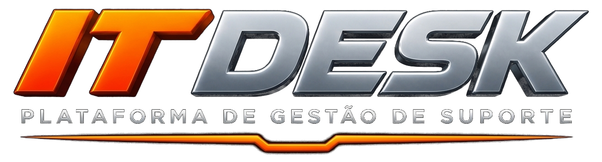
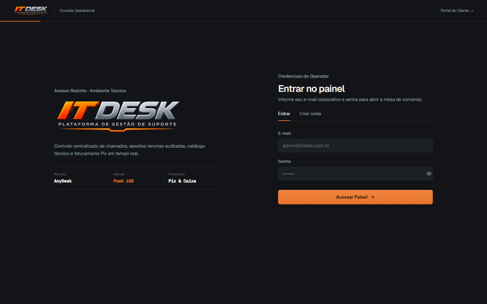
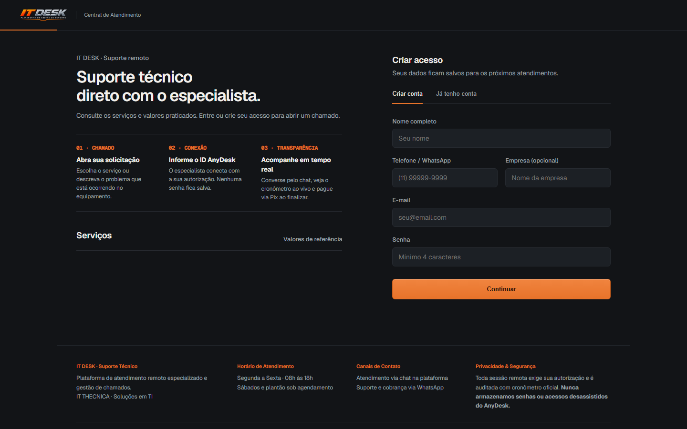
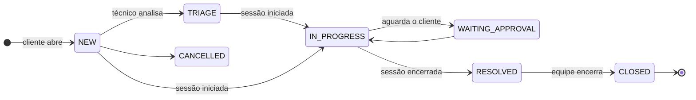
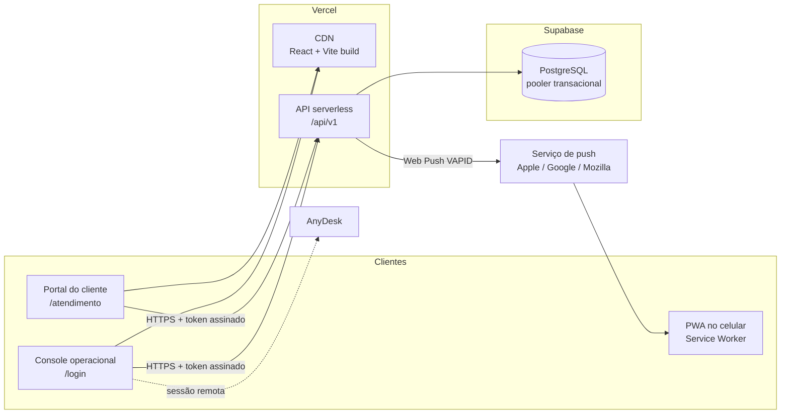
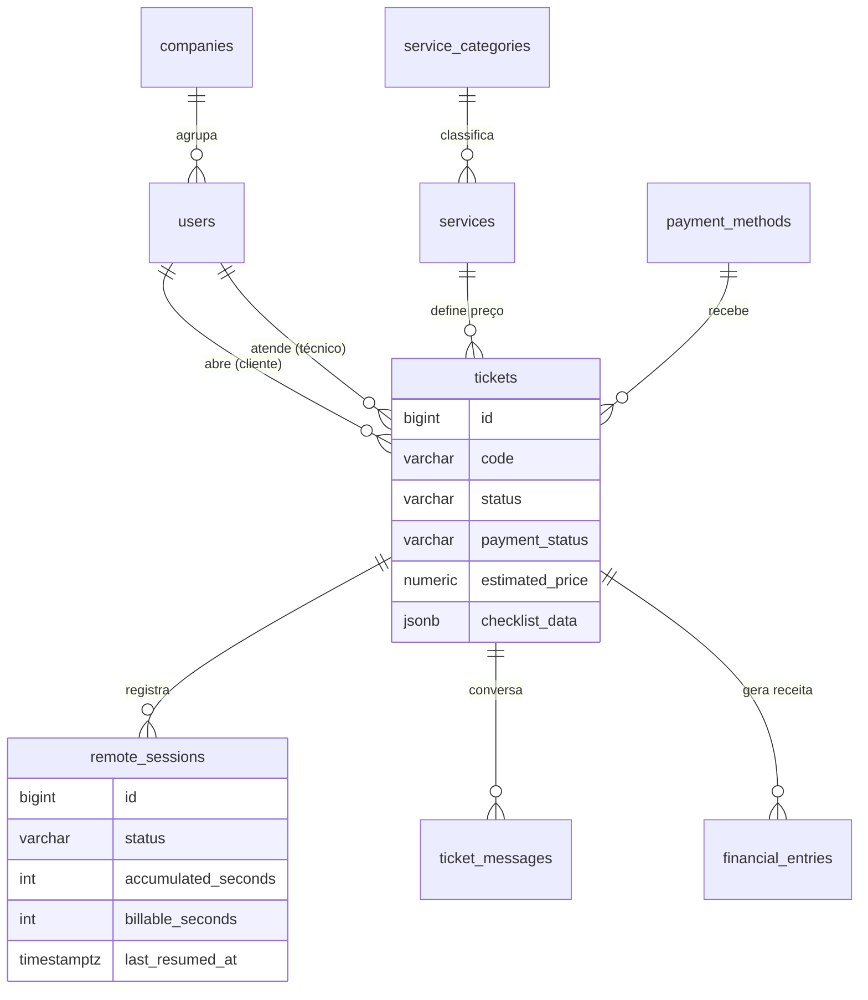
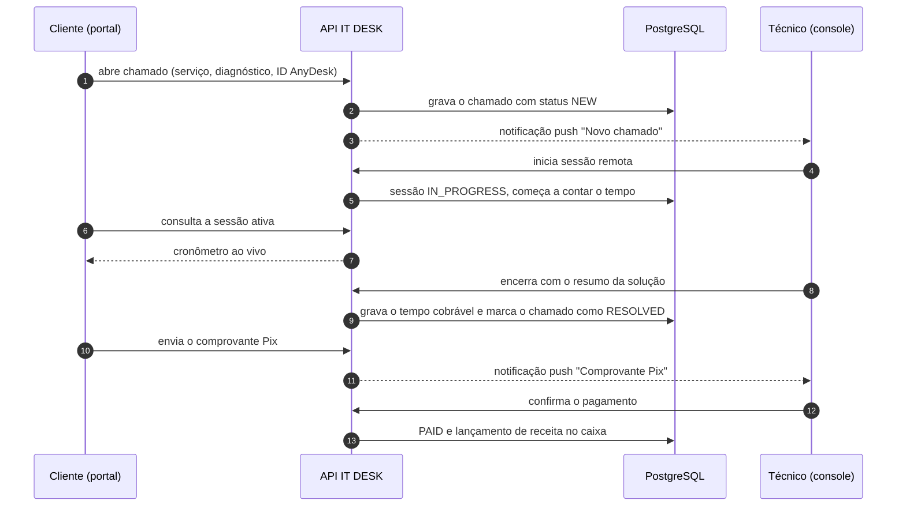

 
 

**Plataforma de gestão de suporte técnico e atendimento remoto**

Chamados, sessões remotas cronometradas, cobrança via Pix e comunicação com o cliente em um só lugar.

 

 
 

[Visão geral](#visão-geral) &nbsp;·&nbsp;
[Como utilizar](#como-utilizar) &nbsp;·&nbsp;
[Tecnologias](#tecnologias) &nbsp;·&nbsp;
[Arquitetura](#arquitetura) &nbsp;·&nbsp;
[System design](#system-design) &nbsp;·&nbsp;
[Segurança](#segurança)

 

## Visão geral

O IT DESK é a plataforma da **IT THECNICA** para atender clientes de TI de ponta a ponta. O cliente abre o chamado, o técnico conecta por AnyDesk com o tempo registrado automaticamente, e o atendimento termina com a cobrança via Pix e a avaliação do serviço.

A plataforma tem duas faces:

| | Console operacional | Portal do cliente |
|:--|:--|:--|
| **Endereço** | `/login` | `/atendimento` |
| **Para quem** | Administradores e técnicos | Clientes da IT THECNICA |
| **Função** | Operar a fila, conduzir sessões, cobrar e gerir clientes | Abrir chamados, acompanhar ao vivo e pagar |

 

<table>
  <tr>
    <td width="50%"></td>
    <td width="50%"></td>
  </tr>
  <tr>
    <td align="center">Console operacional</td>
    <td align="center">Portal do cliente</td>
  </tr>
</table>

 

## Como utilizar

### Console operacional (equipe)

**Primeiro acesso.** Abra `/login` e escolha *Criar conta*. A primeira conta criada vira a do administrador. Depois disso o cadastro de administradores é bloqueado, e as próximas entradas são feitas em *Entrar*.

O menu lateral organiza o trabalho do dia:

| Seção | O que fazer nela |
|:--|:--|
| **Visão Geral** | Ver em um relance a fila aberta, os atendimentos em curso, as horas técnicas e o valor recebido e a receber. |
| **Fila de Chamados** | Abrir cada chamado para ler o diagnóstico do cliente, conversar pelo chat (com notas internas que o cliente não vê) e mudar o status. |
| **Catálogo de Serviços** | Cadastrar serviços com preço de referência, modelo de cobrança (valor fixo ou por hora) e perguntas de diagnóstico que o cliente responde ao abrir o chamado. |
| **Agenda & Horários** | Acompanhar os atendimentos programados. |
| **Faturas & Cobranças** | Cadastrar as chaves Pix, conferir os comprovantes enviados pelos clientes e confirmar os pagamentos. A confirmação lança a receita no caixa. |
| **Clientes & Empresas** | Consultar e cadastrar clientes, empresas, CNPJ e o último ID AnyDesk usado. |
| **App no Celular** | Instalar o IT DESK na tela inicial do celular e ativar as notificações de novos chamados, mensagens e comprovantes. |

**Conduzir um atendimento remoto**

1. Na fila, abra o chamado e copie o ID AnyDesk informado pelo cliente.
2. Inicie a sessão. O cronômetro começa a contar e o cliente vê o mesmo tempo no portal.
3. Pause quando o trabalho for interrompido. O tempo pausado não é cobrado.
4. Ao encerrar, escreva o resumo da solução. O chamado passa para *Resolvido* e a cobrança é calculada a partir do serviço e do tempo registrado.

Use **Ctrl + K** em qualquer tela para buscar chamados e navegar entre as seções.

### Portal do cliente

Envie ao cliente o link `/atendimento`, que fica disponível para cópia no rodapé do menu do console.

1. **Criar acesso.** O cliente informa nome, telefone, e-mail e uma senha de pelo menos 8 caracteres. Os dados ficam salvos para os próximos atendimentos.
2. **Abrir o chamado.** Ele escolhe o serviço, responde às perguntas de diagnóstico e informa o ID AnyDesk.
3. **Acompanhar.** O status, o cronômetro da sessão e o chat com o técnico atualizam sozinhos.
4. **Pagar.** Ao final, o portal mostra o valor e o QR Code Pix. O cliente paga e anexa o comprovante (imagem ou PDF).
5. **Avaliar.** O cliente dá uma nota ao técnico e ao sistema e deixa um comentário.

### Ciclo de um chamado

O pagamento segue um ciclo próprio: **PENDING** (aguardando) → **REPORTED** (cliente enviou o comprovante) → **PAID** (equipe confirmou).

 

## Tecnologias

<table>
  <tr>
    <td><b>Interface</b></td>
    <td>
      
      
      
      
    </td>
  </tr>
  <tr>
    <td><b>API</b></td>
    <td>
      
      
      
    </td>
  </tr>
  <tr>
    <td><b>Dados</b></td>
    <td>
      
      
    </td>
  </tr>
  <tr>
    <td><b>Pagamentos</b></td>
    <td>
      
      
    </td>
  </tr>
  <tr>
    <td><b>Acesso remoto</b></td>
    <td>
      
    </td>
  </tr>
</table>

 

## Arquitetura

O IT DESK é uma aplicação de página única servida pela CDN da Vercel, com uma API serverless na mesma origem e PostgreSQL gerenciado pelo Supabase.

| Camada | Responsabilidade |
|:--|:--|
| **Interface** | Duas experiências (console e portal) no mesmo build, separadas pela rota. O estado é atualizado por consultas periódicas, com intervalo curto nas telas ao vivo. |
| **API** | Uma única função serverless com roteamento próprio. Concentra autenticação, regras de acesso, cálculo de sessão e cobrança. |
| **Banco** | PostgreSQL no Supabase, acessado pelo pooler em modo transação (porta 6543), adequado a funções que abrem e fecham conexões a cada chamada. |
| **Notificações** | Web Push com chaves VAPID. Assinaturas expiradas são removidas automaticamente. |

 

## System design

### Modelo de dados

### Fluxo de um atendimento

### Decisões de projeto

- **Tempo calculado no servidor.** A sessão guarda o tempo acumulado e o momento da última retomada. O total é sempre calculado pela API, então fechar o navegador ou trocar de dispositivo não altera a cobrança.
- **Cobrança a partir do catálogo.** Se o chamado não tem valor definido, o preço vem do serviço escolhido no momento da resolução.
- **Receita lançada uma única vez.** A confirmação de pagamento só gera o lançamento financeiro na primeira transição para PAID.
- **Uma conexão por função.** O pool usa uma conexão por instância, com encerramento rápido quando ociosa, para não esgotar o limite do banco com muitas funções simultâneas.
- **Um único build, duas experiências.** Console e portal compartilham o mesmo pacote, o que simplifica o deploy e mantém o visual consistente.

 

## Segurança

| Controle | Como funciona |
|:--|:--|
| **Autenticação** | Token assinado com HMAC-SHA256, emitido no login e válido por 30 dias. Toda rota, exceto login, cadastro e catálogo público, exige o token. |
| **Controle de acesso** | A equipe acessa tudo. O cliente só alcança os próprios chamados, mensagens e sessões, não vê notas internas e só pode *informar* um pagamento, nunca confirmá-lo. |
| **Senhas** | Armazenadas com scrypt e sal individual, comparadas em tempo constante. Mínimo de 8 caracteres. |
| **Força bruta** | Limite de tentativas de login por IP e por e-mail. |
| **Arquivos** | Comprovantes aceitos só como imagem (PNG, JPG, WEBP) ou PDF, com até 6 MB. PDFs são exibidos em quadro isolado. |
| **Segredos** | Credenciais do banco, chaves VAPID e chave de assinatura ficam apenas em variáveis de ambiente da Vercel. |
| **Acesso remoto** | Toda sessão exige autorização do cliente. A plataforma não armazena senhas nem acessos não assistidos do AnyDesk. |

 

---

**IT DESK** é um produto da **IT THECNICA** — Soluções em TI

Idealizado e desenvolvido por **Daniel Wallans**, CEO da IT THECNICA

© 2026 IT THECNICA. Todos os direitos reservados. Software proprietário: uso, cópia e distribuição dependem de autorização.

