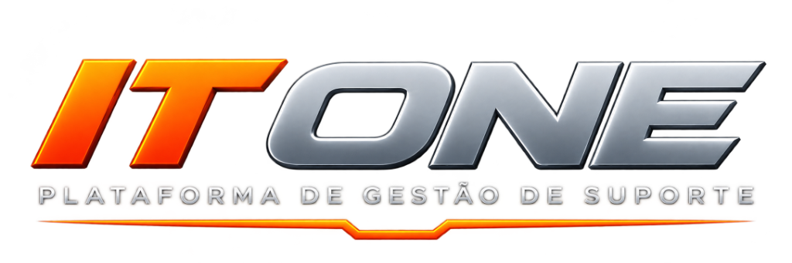
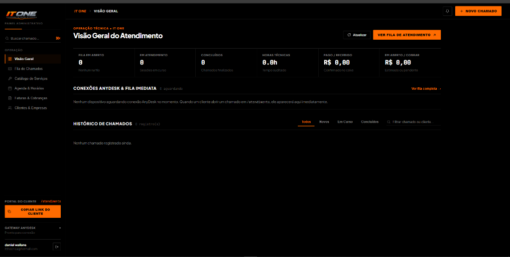

  

  <h3>PLATAFORMA DE GESTÃO DE SUPORTE TÉCNICO & ATENDIMENTO REMOTO</h3>
  
<strong>IT ONE</strong> • Uma solução corporativa desenvolvida por <strong>IT THECNICA</strong>

---

## Sobre a Plataforma

A **IT ONE** é uma plataforma proprietária de gestão operacional para suporte técnico especializado e atendimento remoto auditado, projetada pela **IT THECNICA** para conectar clientes e especialistas em tempo real com transparência de ponta a ponta.

O ecossistema elimina intermediários e centraliza todo o ciclo de um atendimento técnico — desde a abertura do chamado e diagnóstico prévio até a conexão remota via **AnyDesk**, cronometragem oficial de sessão, chat em tempo real e liquidação financeira via **Pix**.

  

---

## Arquitetura de Experiência

A plataforma é dividida em dois ambientes dedicados, desenhados sob uma identidade editorial **Black & Orange** de alto contraste, focada em leitura rápida e precisão operacional:

### 1. Portal Exclusivo do Cliente (`/atendimento`)
Ambiente direto e sem fricção enviado ao cliente para solicitação e acompanhamento de suporte:
- **Catálogo Transparente de Serviços**: Consulta imediata dos serviços prestados, valores de referência (preço fixo ou hora técnica) e tempo estimado de execução.
- **Triagem Inteligente por Serviço**: Perguntas dinâmicas de checklist de acordo com o problema selecionado, acelerando o diagnóstico antes mesmo da conexão remota.
- **Integração Direta com AnyDesk**: Orientação integrada para localização do endereço AnyDesk de 9 dígitos e link oficial de download para o primeiro atendimento.
- **Acompanhamento em Tempo Real**: Indicador visual de etapas (*Na fila → Em atendimento → Concluído*), cronômetro sincronizado ao vivo com o especialista e chat instantâneo no próprio chamado.
- **Pagamento Pix Integrado & Envio de Comprovante**: Geração automática de **QR Code Pix** e código **Pix Copia e Cola** ao encerramento do serviço, com envio de comprovante (imagem ou PDF) diretamente pelo portal e opção de pagamento posterior.
- **Histórico Financeiro Separado**: Distinção clara entre valores **Pagos / Concluídos** e chamados **Em Aberto** para total transparência com o cliente.

---

### 2. Central Operacional do Especialista (`/`)
Painel administrativo de comando e telemetria da **IT THECNICA**:
- **Visão Geral & Telemetria em Tempo Real**: Monitoramento contínuo da fila de espera, sessões AnyDesk ativas, horas técnicas trabalhadas, faturamento confirmado e valores a receber.
- **Alerta Sonoro Instantâneo**: Sistema de notificação sonora cristalina (*Tri-tone*) e alerta visual em tempo real sempre que um novo chamado é aberto ou um comprovante Pix é enviado pelo cliente.
- **Gestão e Auditoria de Sessão Remota**: Controle de início, pausa, retomada e encerramento de sessões AnyDesk com cálculo de tempo persistido no servidor e registro do resumo técnico da solução.
- **Catálogo Dinâmico**: Criação e edição instantânea de serviços, preços e perguntas de triagem, refletindo imediatamente na página pública do cliente.
- **Módulo Financeiro & Cobrança Pix**:
  - Cadastro de chaves Pix e upload de imagem de QR Code oficial.
  - Painel dedicado de **Pagamentos Pendentes (Cobrar Depois)** para atendimentos já finalizados.
  - Visualização de comprovantes anexados pelos clientes, disparo de cobrança formatada direto para o **WhatsApp** do cliente e baixa de pagamento com 1 clique.
  - Controle de caixa completo com registro de entradas, retiradas/despesas e saldo líquido.

---

## Princípios de Segurança & Privacidade

- **Zero Armazenamento de Senhas Remotas**: A plataforma registra exclusivamente o ID público do AnyDesk e o tempo de sessão autorizado pelo cliente. Nenhuma senha ou credencial de acesso desassistido é armazenada.
- **Isolamento de Dados por Cliente**: Cada cliente visualiza unicamente seus próprios chamados, mensagens e histórico financeiro.
- **Auditoria de Tempo no Servidor**: O tempo de atendimento é calculado com base em carimbos de tempo oficiais (`UTC`), garantindo precisão na cobrança por hora técnica ou serviço fechado.

---

  
<strong>© 2026 IT ONE — Todos os direitos reservados a Daniel Wallans · CEO IT THECNICA</strong>

